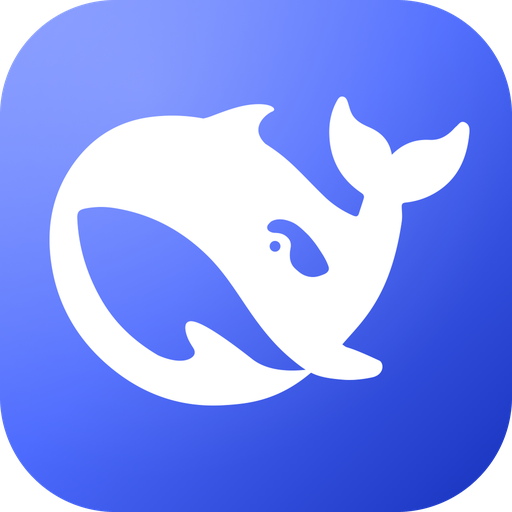
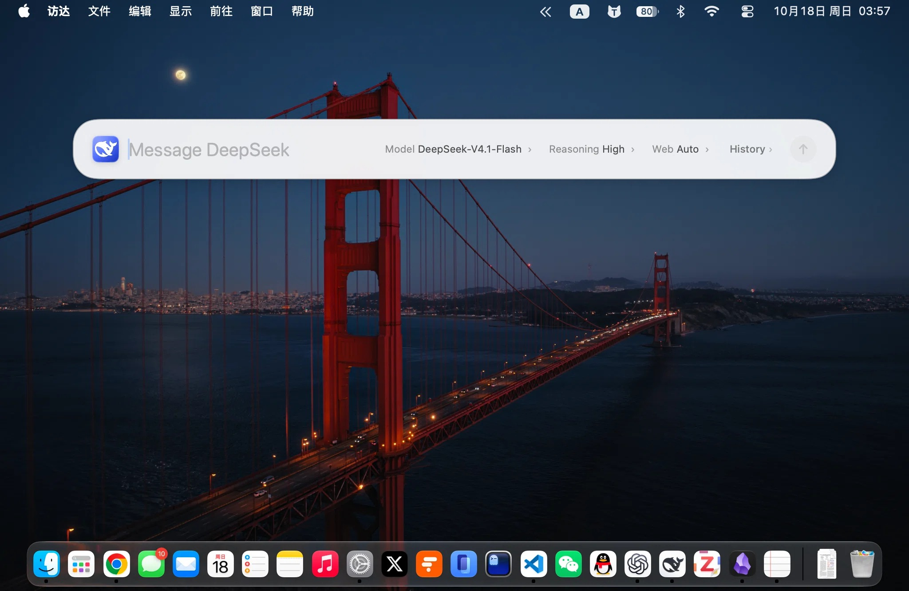
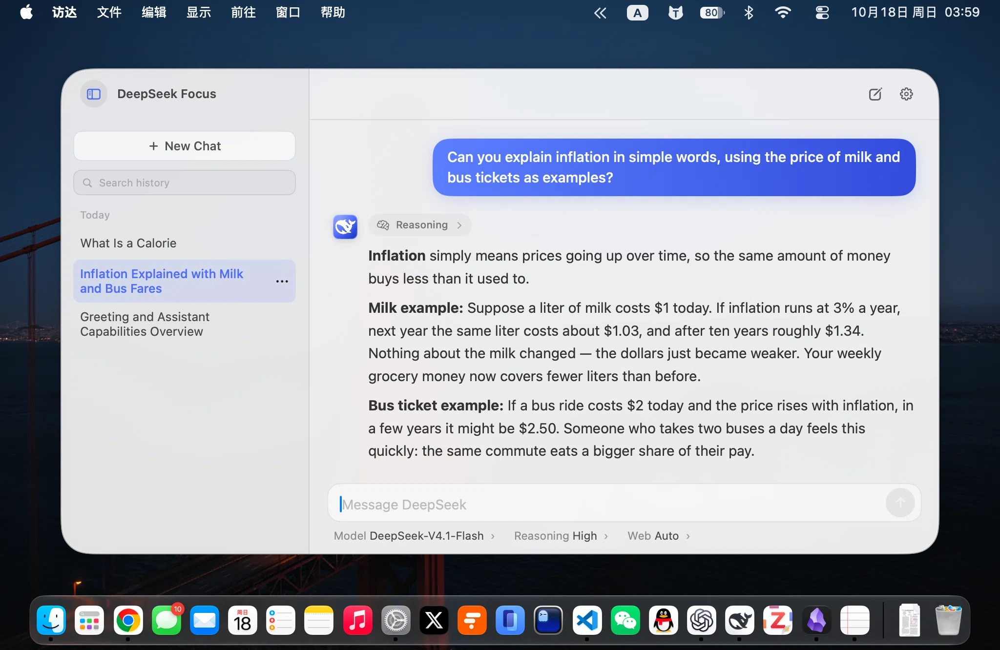

# DeepSeek Focus

**English** | [简体中文](README.zh-CN.md)

<p align="center">
  
</p>

<p align="center">Ask DeepSeek from anywhere, Spotlight-style.</p>

DeepSeek Focus is a native macOS menu bar app. Press a global hotkey to open a floating search panel over any app, ask a question, and keep the conversation going without switching windows.

> **Unofficial project**: This is an independent third-party client, not affiliated with or endorsed by DeepSeek. API usage and search billing are the user's responsibility.

## Screenshots

<p align="center">
  
  
</p>

## Download

Download the DMG from [GitHub Releases](https://github.com/ykn0309/deepseek-focus/releases/latest), open it, and drag `DeepSeek Focus.app` into **Applications**.

The build is ad-hoc signed and not notarized. If macOS blocks it on first launch, right-click the app and choose **Open**, or allow it in **System Settings → Privacy & Security**.

## Features

- **Spotlight-style search**: a floating panel with a global shortcut, default `⌥ Space`.
- **Menu bar access**: left-click the icon to search, right-click for Settings, updates, and quit. Launch at login and icon visibility are configurable.
- **Streaming answers**: reasoning, Markdown, code blocks, tables, quotes, sources, and LaTeX math.
- **Multi-turn chat**: per-chat model, reasoning level, and web search controls.
- **Chat history**: search, resume, rename, and delete up to 50 local chats.
- **Official model list**: verifies your DeepSeek API key and syncs available models and reasoning levels.
- **Chinese and English UI**: follows the system language by default. The model prompt follows the UI language, while replies still match the language of your question. Each chat keeps the language it was created in; changing the UI later only affects new chats.
- **In-app updates**: checks GitHub Releases, downloads and verifies the new build, installs it, and restarts. No manual download required.

## Requirements

- macOS 13 Ventura or later
- A DeepSeek API key with available balance
- Swift 5.9+ only if you build from source

## Usage

1. Open the app and paste your DeepSeek API key in Settings. Until a key is configured, the hotkey and menu bar left-click open Settings instead of the composer.
2. Click **Verify & Sync**, then choose your default model, reasoning level, and web search mode.
3. Set a global shortcut — the default is `⌥ Space`.
4. Press the shortcut anywhere, type a question, and press `Return`.

### Keyboard shortcuts

| Action | Shortcut |
| --- | --- |
| Open / close panel | `⌥ Space` (configurable) |
| Send | `Return` |
| New line | `Shift + Return` |
| New chat | `⌘ N` |
| Settings | `⌘ ,` |
| Close panel | `Esc` |

## Privacy

- The API key is stored only on this Mac and is never sent anywhere except DeepSeek.
- There are no accounts, telemetry, analytics, or relay servers.
- Chat history stays local. Conversations are sent only to `api.deepseek.com`.
- Update checks and downloads contact GitHub; no API key or chat content is included.

## Build from source

```bash
git clone https://github.com/ykn0309/deepseek-focus.git
cd deepseek-focus
./scripts/build_app.sh
```

For SDK setup, tests, API behavior, local data details, and release packaging, see [DEVELOPMENT.md](DEVELOPMENT.md).

## License

MIT. See [LICENSE](LICENSE) and [third-party notices](Resources/THIRD_PARTY_NOTICES.txt).
